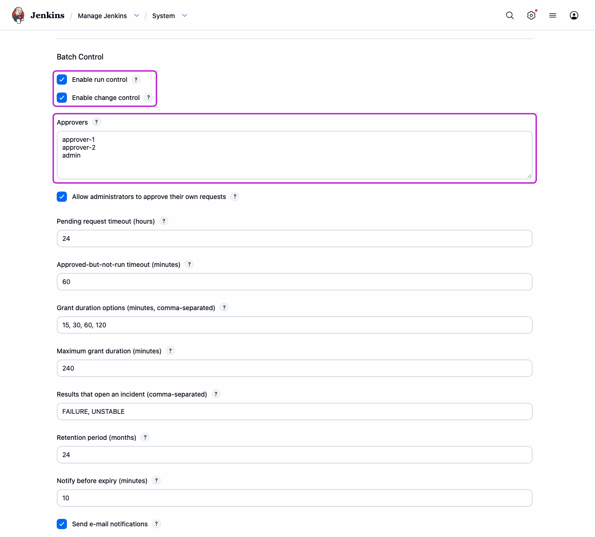
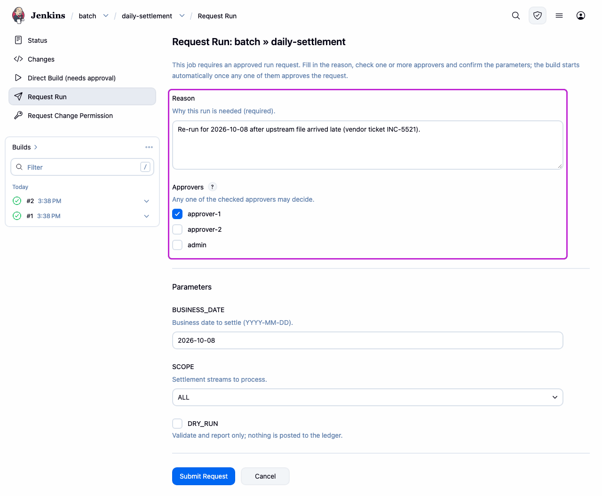
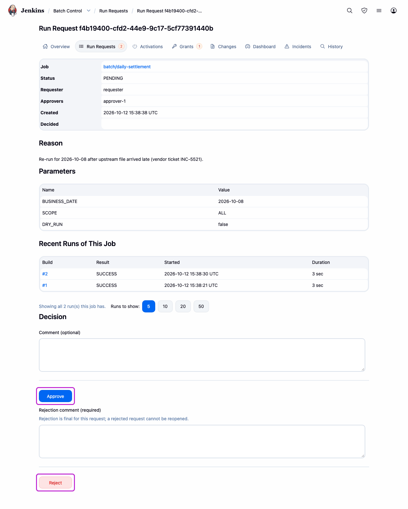
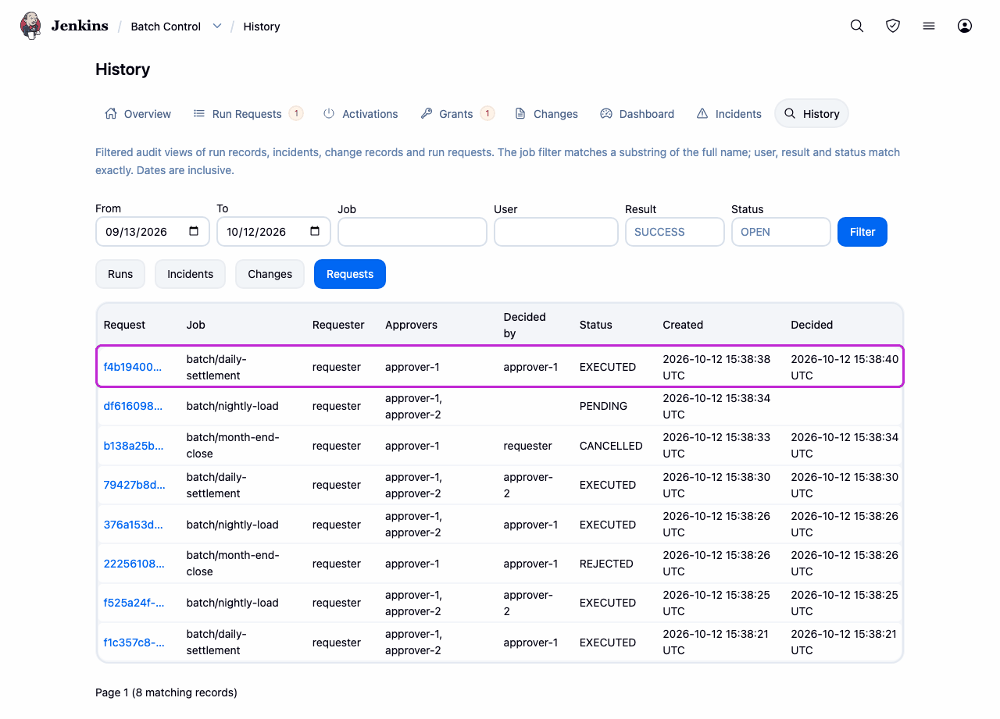
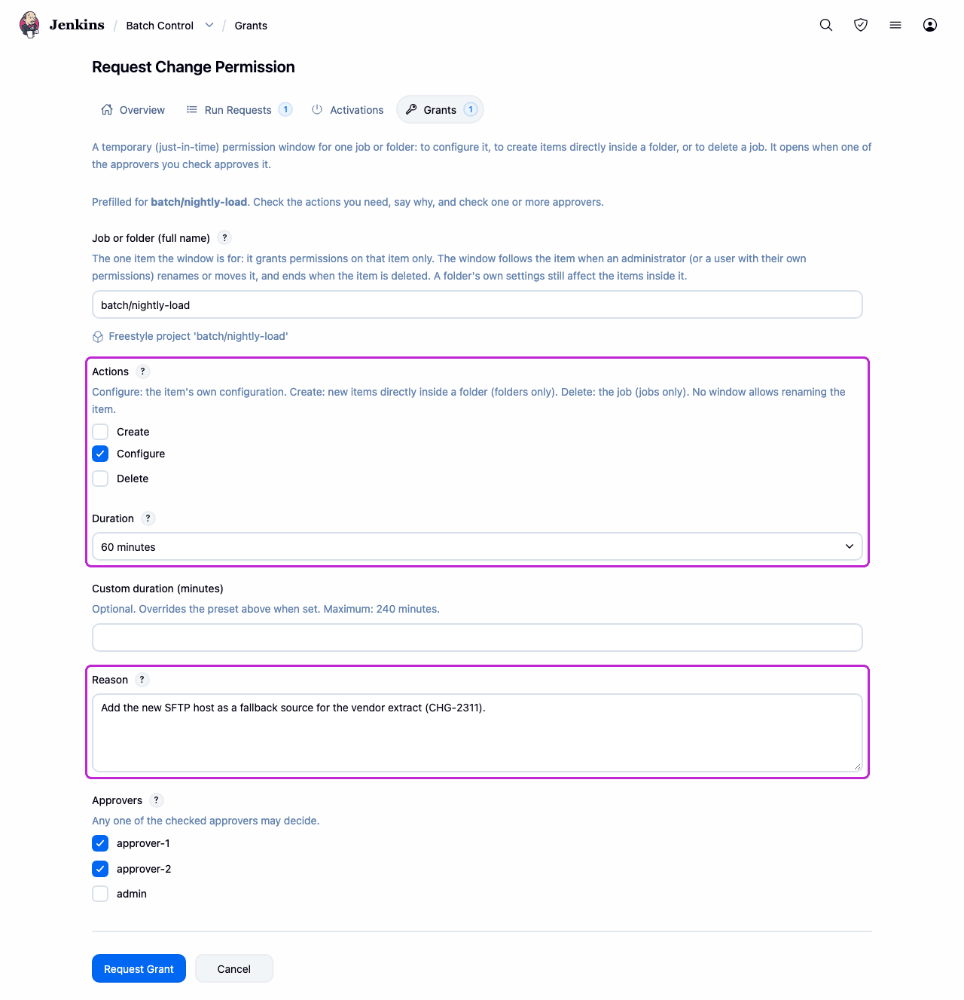
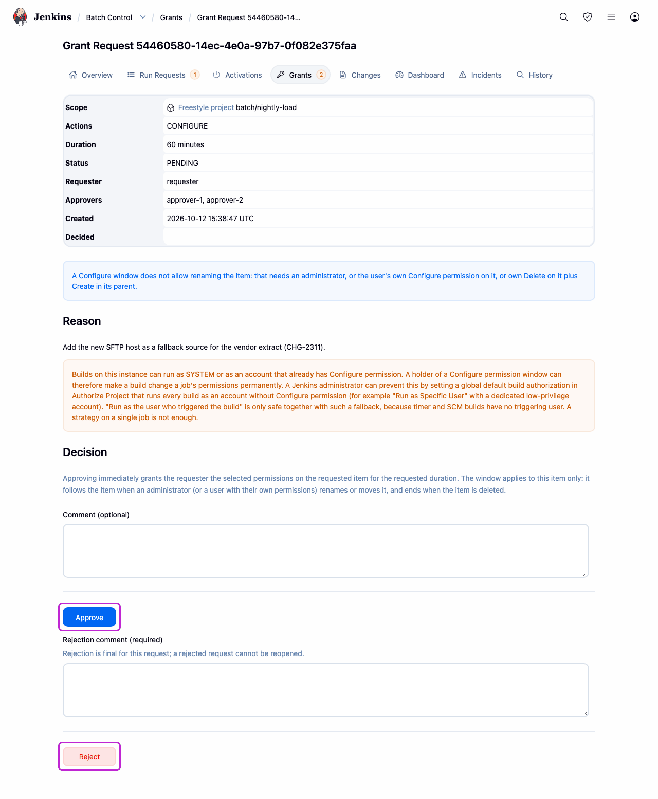

이 문서는 정본인 영문 [README.md](README.md)의 한국어 번역이며 2026-10-13 기준입니다. 두 문서가 어긋나면 영문판이 맞습니다.

# Batch Control

CI 서버가 아니라 **배치 실행 관리 도구**로 운영되는 Jenkins 인스턴스를 위한 실행 승인, 기간
제한 변경 권한, 추가 전용(append-only) 감사 이력.

야간·주기 운영 작업을 Jenkins로 돌리고, 잡을 손으로 시작하거나 잡이 하는 일을 바꾸는 것이 운영
변경인 팀을 위한 플러그인입니다. 설치만으로 달라지는 것은 없습니다. 두 통제 모두 관리자가 켤
때까지 꺼져 있습니다.

## 주요 기능

- **실행 승인.** 사람이 보호된 잡을 수동으로 실행하면(Build Now, REST, CLI, Replay) 큐 진입
  시점에 거부되고 실행 요청이 됩니다. 지정된 결재자만 결정할 수 있고, 승인된 빌드는 결재자가 본
  파라미터를 그대로 받아 한 번만 실행됩니다.
- **활성화.** 실행 통제가 켜진 동안 만든 잡은 결재자가 활성화할 때까지 타이머, 업스트림 트리거,
  SCM 트리거, 웹훅으로 실행되지 않습니다. 기존 잡은 일정대로 계속 실행됩니다.
- **권한 창.** 상시 권한이 없는 사용자가 잡 하나나 폴더 하나에 대해 `CREATE`, `CONFIGURE`,
  `DELETE`를 제한된 시간 동안 요청합니다. 창은 스스로 닫힙니다.
- **빌드와 무관한 감사 이력.** 실행, 요청, 결정, diff가 붙은 설정 변경, 실패가
  `$JENKINS_HOME/batch-control/` 아래에 추가 전용으로 보관되며, 이력 화면과 CSV 내보내기를
  제공합니다.
- **인시던트.** 실패하거나 불안정한 실행은(기본값이며, 설정에서 중단된 실행을 추가할 수
  있습니다) 콘솔 마지막 100줄과 함께 인시던트(오류 건)를 엽니다. 확인, 해결, 요청을 통한
  재실행으로 처리합니다.
- **기존 보안 설정과 맞물림.** Matrix Authorization Strategy와 Role-based Authorization
  Strategy의 Batch Control 변형을 통해 동작합니다. 이메일 알림(기본값은 꺼짐)을 지원하고,
  Configuration as Code로 설정할 수 있습니다.

## 스크린샷

각 스크린샷에 그려 넣은 테두리는 봐야 할 곳을 표시합니다.

### 1. 설정(관리자)

**관리자:** 실행 통제와 변경 통제 중 하나 또는 둘 다를 켜고 결재자 목록을 적습니다.

### 2. 보호된 잡 실행(실행 통제)

**요청자:** 승인이 필요한 잡에서 **Request Run**(실행 요청)을 골라 사유를 적고 결재자를
지정합니다.

**결재자:** 사유와 파라미터를 읽고 **Approve**(승인) 또는 **Reject**(반려)를 고릅니다.

**`BatchControl/ViewHistory` 권한이 있는 사람:** **History**(이력)에서 그 요청을 찾아 누가
요청하고 누가 결정했는지, 그리고 실행되었다는 것을 확인합니다.

### 3. 안전한 잡 변경(변경 통제)

**요청자:** 권한 창(여기서는 잡 하나에 대한 60분간의 `CONFIGURE`)을 요청하고 사유를 적습니다.

**결재자:** 요청 내용을 읽고 **Approve** 또는 **Reject**를 고릅니다. 승인된 창은 시간이 다 되면
스스로 닫힙니다.

## 요구 사항

- **Jenkins 2.568.3 이상**, **Java 21 또는 25**.
- **필수 플러그인:** `cloudbees-folder`, `ionicons-api`, `caffeine-api`. 설치할 때 자동으로
  해결됩니다.
- **권한 매트릭스를 그려 주는 권한 전략**, 예를 들어 Matrix Authorization Strategy나 Role-based
  Authorization Strategy. "Logged-in users can do anything"에서는 Batch Control 권한을 할당할 수
  없습니다.

Batch Control은 아래 플러그인 없이도 로드되지만, 설치되어 있다면 최소 이 버전이어야 합니다.

| 선택 플러그인 | 최소 버전 |
|---|---|
| `matrix-auth` | 3.3 |
| `role-strategy` | 927.v9cf5527c4085 |
| `configuration-as-code` | 2121.v86fe99d4b_b_a_b_ |
| `mailer` | 534.v1b_36f5864073 |
| `rebuild` | 338.va_0a_b_50e29397 |
| `file-parameters` | 433.va_0b_80359d54d |

더 오래된 버전이 설치되어 있으면 Batch Control이 로드되지 않습니다. **Plugins → Available
plugins**는 업그레이드를 함께 제안하지만 **Deploy Plugin**은 제안하지 않으므로, 먼저
업그레이드하십시오.

## 설치

**Manage Jenkins → Plugins → Available plugins**에서 *Batch Control*을 검색해 설치하거나, 직접
빌드한 것을 **Advanced settings → Deploy Plugin**에서 올립니다. 빌드에는 Maven과 JDK 21 또는
25가 필요하며, `mvn clean package`가 `target/batch-control.hpi`를 만듭니다.

## 빠른 시작

1. **Manage Jenkins → System → Batch Control**에서 **Enable run control**을 체크하고(권한 창이
   필요하면 **Enable change control**도), **Approvers**에 결재자의 사용자 ID를 적은 뒤
   저장합니다.
2. 변경 통제를 쓸 때만 Batch Control 전략을 선택합니다. **Manage Jenkins**의 모니터가
   **Install the Batch Control variant**를 제안합니다
   ([자세한 내용](docs/USER-GUIDE.md#2-select-a-batch-control-authorization-strategy)).
3. 요청자에게는 `BatchControl/Request`, 결재자에게는 `BatchControl/Approve`를 주고, 둘 다
   `Overall/Read`와 `Item/Read`도 줍니다.
4. 잡의 **Batch Control** 섹션에서 **Require approval to run**을 체크합니다.
5. 요청자가 잡에서 **Request Run**을 골라 파라미터, 사유, 결재자를 입력하고 제출합니다.
6. 결재자가 **Batch Control**(**☰** 메뉴) → **Run Requests**를 열고 **Approve**(승인) 또는
   **Reject**(반려)를 고릅니다. 승인되면 빌드가 큐에 들어갑니다.

실행 통제가 켜진 동안 만든 잡은 무인 실행 전에 활성화 승인이 필요합니다
([활성화](docs/USER-GUIDE.md#activation-putting-a-job-into-service)). 전체 설정 방법은
[사용자 가이드](docs/USER-GUIDE.md#configuration)에 있습니다(영문. 사용자 가이드와 제약 목록은
영문으로만 제공됩니다).

## 권한

| 권한 | 허용하는 것 |
|---|---|
| `BatchControl/Request` | 실행, 활성화, 보류 요청 생성(그 잡의 `Item/Read` 필요, `Item/Build`는 필요 없음) |
| `BatchControl/Approve` | 실행, 활성화, 보류, 권한 창 요청의 승인 또는 반려 |
| `BatchControl/RequestGrant` | 임시 변경 권한 요청 |
| `BatchControl/ViewHistory` | 모든 잡에 대한 이력 화면, 대시보드, CSV 내보내기 조회 |
| `BatchControl/Manage` | 전역 설정 관리와 권한 창 회수(`Overall/Administer`가 함의) |

[전체 규칙](docs/USER-GUIDE.md#3-assign-the-permissions).

## 문서

- [사용자 가이드](docs/USER-GUIDE.md): 두 통제의 동작, 설정, 화면, 알림, 그리고 결정을 바꾸는
  [제약](docs/USER-GUIDE.md#limitations).
- [알려진 제약](docs/LIMITATIONS.md): 전체 목록.
- 이슈와 기능 요청: <https://github.com/jenkinsci/batch-control-plugin/issues>.

## 기여

이슈와 풀 리퀘스트를 환영하며, 안내서는 [`CONTRIBUTING.md`](CONTRIBUTING.md)입니다.
`docs/SPEC.md`는 기능 계약이고(코드와 스펙이 어긋나면 코드가 틀린 것입니다), 이 문서와
`docs/DECISIONS.md`, `docs/ARCHITECTURE.md`는 대부분 한국어로 쓰였으며 새로 추가된 절은
영어입니다.

## 보안 취약점 신고

GitHub 이슈는 **열지 마십시오.** Jenkins의
[**SECURITY** 프로젝트](https://issues.jenkins.io/secure/CreateIssueDetails!init.jspa?pid=10180&issuetype=10103)에
`specific-plugin` 컴포넌트로 비공개 신고하고 요약에 플러그인 이름을 적거나,
`jenkinsci-cert@googlegroups.com`으로 메일을 보내십시오. 전체 정책:
<https://www.jenkins.io/security/reporting/>.

## 라이선스

MIT. [`LICENSE`](LICENSE) 참고.
